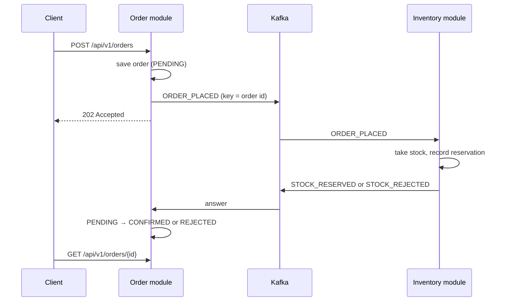

# orderflow

[](https://github.com/ARDAVAN39/orderflow/actions/workflows/ci.yml)

An event-driven order service built with Quarkus, MongoDB and Kafka. Customers place orders over
a REST API; an inventory module reserves the stock; the two talk to each other only through Kafka
events. The project focuses on what makes messaging hard in practice: duplicates, ordering,
lost messages and two orders competing for the same stock.

## How it works



Cancelling a confirmed order publishes `ORDER_CANCELLED`, and the inventory gives the stock back.

The order and inventory modules live in one deployable, but the inventory never reads the order
collection and the order module never touches stock. Splitting them into two services would mean
moving code, not redesigning it.

## Run it

You need Docker.

```bash
docker compose up --build
```

```bash
# put 10 units of a product in stock
curl -X PUT localhost:8080/api/v1/stock/BOOK-1 \
  -H 'Content-Type: application/json' -d '{"available": 10}'

# place an order
curl -i -X POST localhost:8080/api/v1/orders \
  -H 'Content-Type: application/json' \
  -d '{"customerId": "c-1", "lines": [{"sku": "BOOK-1", "quantity": 2, "unitPrice": 12.50}]}'

# a moment later it is CONFIRMED and 8 units are left
curl localhost:8080/api/v1/orders/<id>
curl localhost:8080/api/v1/stock/BOOK-1
```

API documentation: <http://localhost:8080/q/swagger-ui>. Health: <http://localhost:8080/q/health>.

For development, `mvn quarkus:dev` starts MongoDB and Kafka in containers by itself (Quarkus Dev
Services) and reloads code on every change.

### Native image

```bash
mvn package -Dnative -Dquarkus.native.container-build=true
APP_DOCKERFILE=src/main/docker/Dockerfile.native docker compose up --build
```

The native build needs no local GraalVM; it runs in a container.

## API

| Method | Path | Description |
|---|---|---|
| `POST` | `/api/v1/orders` | Place an order. Returns `202` and a `Location` header. |
| `GET` | `/api/v1/orders/{id}` | Get an order. |
| `GET` | `/api/v1/orders?status=&page=&size=` | List orders, newest first. |
| `POST` | `/api/v1/orders/{id}/cancel` | Cancel a pending or confirmed order. `409` if already rejected or cancelled. |
| `PUT` | `/api/v1/stock/{sku}` | Set the available quantity of a SKU. |
| `GET` | `/api/v1/stock/{sku}` | Get the available quantity of a SKU. |
| `GET` | `/api/v1/stock` | List all stock levels. |

## Design decisions

**Every event is keyed by order id.** Kafka keeps messages with the same key on one partition, in
order. A cancellation can never reach the inventory before the placement it cancels.

**Consumers are idempotent.** Kafka delivers at least once, so every handler expects duplicates.
The inventory keeps one reservation document per order id. A repeated `ORDER_PLACED` finds it and
gets the same answer again instead of taking stock twice. Order status changes only happen from an
expected status (`PENDING → CONFIRMED`), so a repeated answer changes nothing.

**Taking stock is one conditional update.** `{_id: sku, available: {$gte: n}}` with
`$inc: {available: -n}` either succeeds atomically or not at all. Two orders competing for the
last units cannot both win, and stock never goes below zero, without any locks. An order with
several lines takes them one by one and puts back what it took if a later line is short.

**Status changes are compare-and-set.** The order module never loads an order, changes it and
saves it. It sends `update ... where _id = ? and status in (...)`, so a cancel request and a
Kafka answer arriving at the same moment cannot overwrite each other.

**Publishing is retried, not transactional.** Saving an order and publishing its event are two
writes that cannot be made atomic without extra infrastructure. If publishing fails, the request
still succeeds and the order stays `PENDING`. A scheduled job publishes again for orders that have
been pending for over a minute, and for cancellations Kafka never acknowledged. Idempotent
consumers make the retries safe. A cancellation that reaches the inventory before its placement
leaves a marker, so the late placement does not reserve stock.

**Failures go to a dead-letter topic.** A message that cannot be handled is moved to
`dead-letter-topic-<channel>` instead of stopping the consumer or being retried forever.

**Blocking work stays off the event loop.** The Kafka handlers use the blocking MongoDB client,
so they are marked `@Blocking` and run on worker threads, still one message at a time.

## Tests

```bash
mvn verify
```

The tests need Docker: Quarkus Dev Services start a real MongoDB and Kafka.

- `OrderTest`: order totals and validation, plain unit tests.
- `InventoryServiceTest`: reservation, rejection with rollback, duplicates, release, and a
  cancellation that overtakes its placement, against a real MongoDB.
- `OrderApiTest`: status codes, validation and response shapes.
- `OrderFlowTest`: the full conversation through Kafka, including two orders racing for the last
  units.

CI also starts the Compose stack, once with the JVM image and once with the native image, and
runs [`scripts/smoke-test.sh`](scripts/smoke-test.sh) against it.

## Limitations and next steps

- **Outbox.** The retry job gives at-least-once publishing, but an event can still be delayed by up
  to a minute after a broker outage. A transactional outbox (write the event to MongoDB in the
  same transaction as the order, publish from there) would remove the gap. It needs MongoDB
  running as a replica set.
- **Crash between steps.** If the inventory crashes after taking stock but before recording the
  reservation, the redelivered event takes the stock again. A MongoDB transaction around both
  writes would fix it, with the same replica-set requirement.
- **Prices come from the caller.** In a larger system a catalog or cart service would price the
  lines. There is no authentication; the service is meant to sit behind a gateway.

## Tech stack

Java 21 · Quarkus 3.33 LTS · MongoDB 7 with Panache · Apache Kafka · SmallRye Reactive
Messaging · Hibernate Validator · GraalVM native image (Mandrel) · Docker · GitHub Actions

## License

[MIT](LICENSE)
